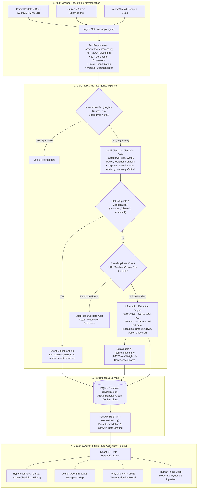

# CivicPulse — Hyperlocal Actionable Civic Alert Intelligence

[](https://www.python.org/)
[](https://fastapi.tiangolo.com)
[](https://react.dev)
[](https://www.typescriptlang.org)
[](https://tailwindcss.com)
[](https://spacy.io/)
[](https://docs.pytest.org)
[](https://opensource.org/licenses/MIT)

> **CivicPulse** is an end-to-end Natural Language Processing (NLP) system and full-stack civic platform that transforms noisy, unstructured municipal notices, news wire reports, and emergency tweets into hyperlocal, actionable alerts for citizens across Greater Hyderabad.

---

## 🌟 Key Highlights & Capabilities

- 📍 **Hyperlocal to 32 Hyderabad Localities:** Filters and geolocates alerts across Gachibowli, Madhapur, Begumpet, Hitec City, Charminar, Kukatpally, Banjara Hills, and more using spatial Haversine distance.
- 🛡️ **Source Credibility Tiering:** Automatically classifies sources into **Official** (GHMC, HMWSSB, TGSPDCL, HYDTP), **News Media** (The Hindu, Telangana Today, Deccan Chronicle), or **Unverified** (Crowdsourced / Citizen reports).
- 🔄 **Near-Duplicate Suppression & Event Linking:** Uses TF-IDF cosine similarity ($\ge 0.58$) and URL matching to detect duplicate incident reports on ingestion without spamming the feed. Automatically resolves or updates existing alerts when resolution notices (*"cleared"*, *"restored"*, *"resumed"*) arrive.
- 🔍 **Explainable AI (XAI):** Built-in LIME (Local Interpretable Model-agnostic Explanations) token attribution reveals exactly *why* a report was classified under a category or urgency level.
- 🌐 **Multilingual Accessibility:** Real-time on-the-fly translation into **Telugu (తెలుగు)**, **Hindi (हिंदी)**, and **English**.
- 📴 **100% Offline-Capable Heuristic Fallback:** If LLM quota is unavailable, deterministic regex, gazetteer lookups, and spaCy NER automatically take over without downtime.

---

## 🏛️ System Architecture



---

## 📁 Repository Structure

```
ALT_Project/
├── client/                     # Frontend Application (React 18, Vite, TypeScript, Tailwind)
│   ├── src/
│   │   ├── components/         # AlertCard, FilterBar, MapView, AdminPanel, Header
│   │   ├── services/api.ts     # FastAPI client integration with Axios/Fetch
│   │   ├── types/index.ts      # TypeScript interfaces and Hyderabad coordinates
│   │   └── App.tsx             # Root application shell (Feed, Map, Admin views)
│   └── vite.config.ts          # Vite configuration with IPv4 proxy to FastAPI
│
├── server/                     # Backend Application (FastAPI, SQLAlchemy, scikit-learn)
│   ├── api/
│   │   ├── routes.py           # REST endpoints (/alerts, /ingest, /classify, etc.)
│   │   └── middleware.py       # CORS & SlowAPI rate limiting configuration
│   ├── db/
│   │   ├── database.py         # SQLAlchemy engine & session maker
│   │   ├── models.py           # ORM schemas (Alert, Report, Area, CommunityConfirmation)
│   │   └── crud.py             # Database query operations and spatial radius filters
│   ├── nlp/
│   │   ├── classifiers.py      # Logistic Regression & Calibrated SVM classifiers
│   │   ├── clustering.py       # KMeans & Latent Dirichlet Allocation (LDA) models
│   │   ├── features.py         # TF-IDF, FastText & DistilBERT vectorizers
│   │   ├── gazetteer.py        # 32 Hyderabad localities with Haversine distance
│   │   ├── ner.py              # spaCy NER pipeline for local entities
│   │   ├── preprocess.py       # Configurable text cleaning & lemmatization
│   │   ├── time_extractor.py   # Regex & dateparser disruption window extractor
│   │   └── xai.py              # LIME local feature attribution explainer
│   ├── services/
│   │   ├── pipeline.py         # End-to-end processing pipeline & duplicate detection
│   │   ├── gemini_service.py   # Gemini LLM structured extraction with offline fallback
│   │   ├── multilingual.py     # English -> Telugu / Hindi translation service
│   │   └── rss_service.py      # RSS feed parsing & web article scraper
│   ├── config.py               # Settings loaded from environment variables
│   └── main.py                 # FastAPI application factory and lifespan loader
│
├── tests/                      # Automated Test Suite (50 Passing Tests)
│   ├── test_classifier.py      # Model accuracy & category inference
│   ├── test_dedup.py           # Deduplication & near-duplicate clustering
│   ├── test_delivery.py        # SMS / Telegram / Digest delivery
│   ├── test_feedback_monitoring.py # Model drift & citizen corrections
│   ├── test_gazetteer.py       # Locality lookup & Haversine distance
│   ├── test_hyperlocal.py      # Proximity radius filtering
│   ├── test_multilingual.py    # Telugu & Hindi translations
│   ├── test_preprocess.py      # Contractions, emojis, lemmatization
│   ├── test_spam_filter.py     # Binary spam classifier
│   ├── test_time_extraction.py # Disruption time intervals
│   └── test_trust_updates.py   # Source tiering & event linking
│
├── notebooks/                  # 5 Capstone Jupyter Notebooks (CO1 to CO4)
├── seed/                       # Dataset generators & real Hyderabad civic corpus
├── requirements.txt            # Python dependencies
└── README.md                   # Project documentation
```

---

## 🚀 Quickstart Guide

### 1. Prerequisites
- **Python 3.11+** installed
- **Node.js 18+** and `npm` installed
- *(Optional)* Gemini API Key for LLM extraction (offline fallback automatically active if omitted)

---

### 2. Backend Setup (FastAPI)

1. **Open a terminal in the project root** and create a Python virtual environment:
   ```powershell
   # Windows PowerShell:
   python -m venv .venv
   .venv\Scripts\activate

   # macOS / Linux:
   python3 -m venv .venv
   source .venv/bin/activate
   ```

2. **Install Python dependencies:**
   ```bash
   pip install -r requirements.txt
   ```

3. **(Optional) Configure environment variables:**
   Create a `.env` file in the root directory (or use `.env.example` defaults):
   ```ini
   DATABASE_URL=sqlite:///./civicpulse.db
   PORT=8000
   GEMINI_API_KEY=your_gemini_api_key_here   # Optional: offline fallback is built-in
   ```

4. **Launch the FastAPI Server:**
   ```bash
   python -m uvicorn server.main:app --host 127.0.0.1 --port 8000 --reload
   ```
   - API is live at: `http://127.0.0.1:8000`
   - Interactive Swagger docs: `http://127.0.0.1:8000/docs`

---

### 3. Frontend Setup (React 18 + Vite)

1. **Open a second terminal window** in the `client/` directory:
   ```bash
   cd client
   npm install
   ```

2. **Start the Vite development server:**
   ```bash
   npm run dev
   ```
   - Open your browser at: `http://localhost:3000`

---

## 🧪 Automated Testing

CivicPulse includes comprehensive unit and integration tests covering the entire NLP pipeline, classifiers, deduplication, and database operations.

Run the test suite:
```bash
pytest -v
```

```
============================= test session starts =============================
tests/test_classifier.py .....                                           [ 10%]
tests/test_dedup.py ...                                                  [ 16%]
tests/test_delivery.py ...                                               [ 22%]
tests/test_feedback_monitoring.py ...                                    [ 28%]
tests/test_gazetteer.py ......                                           [ 40%]
tests/test_hyperlocal.py ....                                            [ 48%]
tests/test_multilingual.py ....                                          [ 56%]
tests/test_preprocess.py .....                                           [ 66%]
tests/test_real_eval.py ....                                             [ 74%]
tests/test_schemas.py ....                                               [ 82%]
tests/test_spam_filter.py ..                                             [ 86%]
tests/test_time_extraction.py ....                                       [ 94%]
tests/test_trust_updates.py ...                                          [100%]
============================= 50 passed in 16.63s =============================
```
*All 50 unit tests run with random seed `42` for 100% deterministic reproducibility.*

---

## 📡 REST API Reference

| Method | Endpoint | Description |
|---|---|---|
| `GET` | `/health` | Server health check and model loading status |
| `GET` | `/api/alerts` | Query alerts filtered by `area`, `category`, `severity`, `status`, `lat`, `lng`, `radius_km`, and `lang` (`en`, `te`, `hi`) |
| `GET` | `/api/alerts/{id}` | Retrieve complete alert payload by ID |
| `GET` | `/api/alerts/{id}/explain` | Return LIME token attribution feature weights for model explainability |
| `GET` | `/api/alerts/{id}/multilingual` | Fetch translated alert in Telugu (`te`), Hindi (`hi`), or English (`en`) |
| `POST` | `/api/alerts/{id}/confirm` | Submit citizen community verification vote (*"Water restored"* vs *"Still disrupted"*) |
| `POST` | `/api/ingest` | Ingest raw news text or article URL through spam filter, classification, deduplication, and extraction |
| `POST` | `/api/classify` | Stateless text classification returning category, severity, and spam probability |
| `GET` | `/api/gazetteer/localities` | List all 32 canonical Hyderabad localities with GPS coordinates |
| `GET` | `/admin/review-queue` | Retrieve alerts flagged for human-in-the-loop review |
| `PATCH` | `/admin/alerts/{id}` | Approve, edit, or reject alerts in the moderation queue |

---

## 🗺️ How CivicPulse Differs from Google Maps

| Feature | Google Maps | CivicPulse |
|---|---|---|
| **Primary Focus** | Navigation & live vehicular route congestion | Hyperlocal public infrastructure disruptions & municipal lifelines |
| **Notification Timing** | Reactive: alerts *while driving* that traffic is backed up | Proactive: notifies *hours or days in advance* so citizens can prepare |
| **Causal Context** | Shows a red line without explaining *why* | Explains root cause (e.g. 500mm pipeline burst, tree fall, culvert repair) with source link |
| **Non-Transit Coverage** | Zero visibility into municipal lifelines | Full coverage of drinking water cuts (HMWSSB), power outages (TGSPDCL), health camps |
| **Actionable Guidance** | Suggests an alternative road detour | Provides tailored action checklists (e.g. *"Store 50L drinking water"*, *"Charge power banks"*) |

---

## 📄 License

This project is licensed under the [MIT License](LICENSE).
