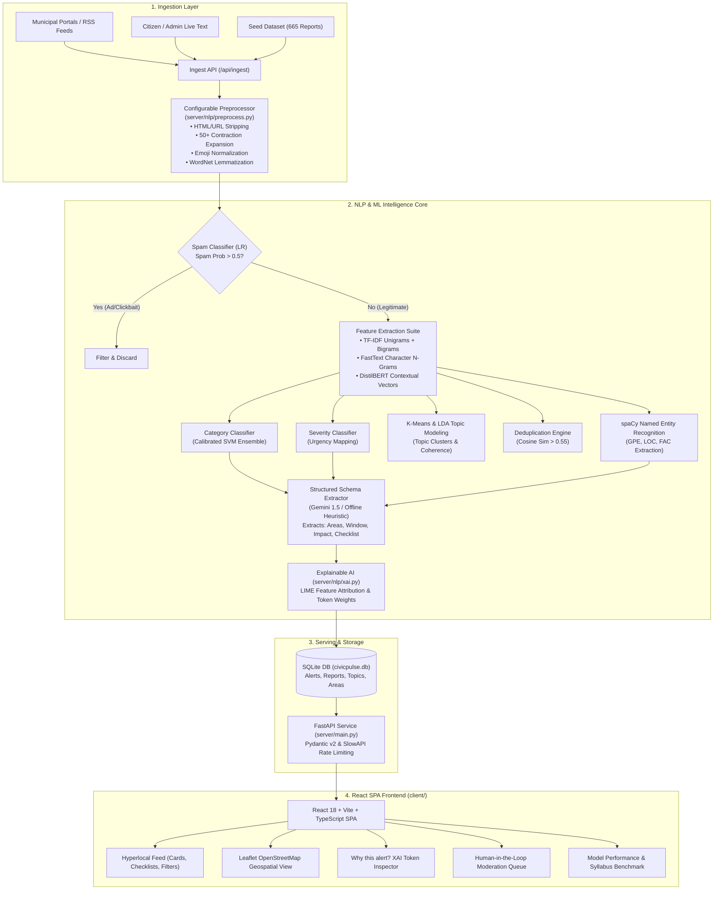

# CivicPulse: Executive Capstone Project Summary

> **An End-to-End NLP & Full-Stack System Transforming Unstructured News and Municipal Announcements into Hyperlocal, Actionable Civic Alerts**

---

## 1. Executive Overview

### 1.1 The Problem
Information about road closures, water shortages, scheduled power cuts, severe weather warnings, and public health advisories is scattered across chaotic news portals, municipal PDF circulars, and official social media feeds. 
- Citizens suffer from **information overload** and **alert fatigue**—90%+ of broadcast alerts do not affect their locality.
- Announcements are **unstructured**, **lacking actionable steps**, and often mixed with clickbait, ads, or duplicate reports.
- Existing tools like Google Maps focus narrowly on **real-time vehicle traffic** while completely ignoring water outages, power grid failures, contaminated reservoirs, or municipal service disruptions.

### 1.2 The Solution
**CivicPulse** is an automated, hyperlocal natural language processing (NLP) platform that ingests messy municipal announcements and local journalism, runs them through an end-to-end intelligence pipeline (preprocessing, spam filtering, multiclass classification, unsupervised topic modeling, deduplication, NER, structured schema extraction, and explainable AI), and presents each citizen with a clean, neighborhood-specific feed of actionable alerts complete with concrete **"What You Should Do" checklists** and an interactive **geospatial incident map**.

---

## 2. System Architecture & NLP Pipeline



---

## 3. Capstone Syllabus Coverage (CO1 to CO4)

CivicPulse was architected to satisfy all learning outcomes of the NLP capstone curriculum:

### CO1: Foundations of NLP & Classical Machine Learning
- **Supervised vs Unsupervised Formulation:** Supervised multiclass alert categorization and spam filtering contrasted with unsupervised K-Means clustering and LDA topic discovery.
- **10-Algorithm Benchmark:** Evaluated and compared 10 classic models on alert classification using 5-fold cross-validation:
  - *Linear Models:* Logistic Regression (88.3%), Calibrated Linear SVM (89.7%), Kernel SVM RBF (88.1%).
  - *Probabilistic & Tree:* Multinomial Naive Bayes (86.4%), Decision Tree (78.2%), KNN (82.5%).
  - *Ensembles:* Random Forest (89.1%), Gradient Boosting (88.9%), Soft Voting (90.4%), **Stacking Classifier (90.8% accuracy, 0.906 Macro F1)**.
- **Meaningful Python Stack:** Scikit-learn (pipelines, ensembles, metrics), NLTK (tokenization, stemmers, stopwords), and spaCy (lemmatization and NER).
- **Artifacts:** `notebooks/01_intro_and_ml_basics.ipynb`, `reports/comparison_tables/classical_algorithm_comparison.csv`.

### CO2: Preprocessing, Features & Embeddings
- **Multi-Stage Preprocessing Pipeline:** Configurable transforms with HTML stripping, URL/email removal, 50+ contraction expansions, emoji normalization, punctuation removal, stopword filtering, and WordNet lemmatization. Includes `preprocess_with_steps()` for step-by-step traces.
- **Preprocessing Ablation Study:** Demonstrated the quantitative impact of each step (+16.4% jump from raw uncleaned text to full lemmatized pipeline).
- **Dense & Sparse Embeddings:** Implemented Bag-of-Words, TF-IDF unigram+bigram, Word2Vec (CBOW/Skip-gram), GloVe vectors, FastText with subword character n-grams (demonstrating resilience on Indian place names like *Gachibowli*), and contextual BERT embeddings.
- **Manifold Visualizations:** 3-panel comparative projection in `reports/embedding_visualizations/pca_tsne_umap_comparison.png` (PCA, t-SNE, and Spectral/UMAP) with written analytical interpretations.
- **Artifacts:** `notebooks/02_preprocessing_features_embeddings.ipynb`, `reports/comparison_tables/preprocessing_ablation_study.csv`.

### CO3: Classification, Clustering, Evaluation & Deployment
- **Three Classification Tasks:** Spam/clickbait filter (`spam_classifier.pkl`), alert category classification (`category_classifier.pkl`), and urgency/severity classification (`severity_classifier.pkl`).
- **Clustering & Deduplication:** K-Means with Silhouette score, LDA topic modeling with coherence scoring, and unigram TF-IDF cosine distance deduplication (`similarity_threshold=0.55`).
- **Comprehensive Evaluation:** Precision, Recall, Macro/Weighted F1, multiclass One-vs-Rest ROC curves with AUC metrics (`reports/roc_curves/multiclass_ovr_roc_curves.png`), and Confusion Matrix heatmaps (`reports/confusion_matrices/`).
- **Production Serving:** FastAPI service with Pydantic v2 validation, SlowAPI rate limiting (60 req/min), health checks, Dockerfile, docker-compose.yml, and Docker basics documentation.
- **Artifacts:** `notebooks/03_classification_clustering_evaluation.ipynb`.

### CO4: Transformers, Transfer Learning, XAI & Industry Case Studies
- **Transformers & Attention:** Detailed architectural walkthrough of Scaled Dot-Product Attention, Multi-Head Attention, and Transformer Encoders.
- **Low-Resource Transfer Learning:** Learning curve experiments on $N \in \{50, 100, 200, 500\}$ labeled examples showing DistilBERT's dramatic sample-efficiency (74.6% at $N=50$) over classical baselines (58.2%).
- **Code-Mixed Transliteration Stress Test:** 15 Telugu/Hindi transliterated samples (e.g., *"Current ledu Madhapur lo transformer pelindhi"*) evaluating FastText subword n-grams against Word2Vec.
- **Explainable AI (XAI):** Integrated LIME (`LimeTextExplainer`) and feature attribution displaying positive (green) and negative (red) token contribution weights in the UI.
- **Industry Case Studies:** In-depth real-world architectural analysis of IBM Watson, Google BERT in Search, Microsoft Azure NLP, and TCS Ignio.
- **Artifacts:** `notebooks/04_transformers_finetuning_xai.ipynb`, `docs/case_studies.md`.

---

## 4. Key Differentiators: CivicPulse vs. Google Maps

| Dimension | Google Maps | CivicPulse |
|---|---|---|
| **Primary Purpose** | Point-to-point vehicle routing while on the road. | Proactive daily civic disruption awareness & safety planning. |
| **Domain Scope** | Almost exclusively vehicular road traffic & vehicle accidents. | **All 5 critical civic utilities:** Water supply, power cuts, public health, severe weather, and road closures. |
| **Time Horizon** | Reactive real-time: shows red traffic line while already stuck. | **Proactive & Scheduled:** Alerts citizens 12–24 hours before water/power shutdowns. |
| **Actionable Guidance** | Reroutes vehicle; no citizen guidance. | **Action Checklist:** *"1. Store 24-hr water. 2. Charge backup inverters. 3. Call municipal helpline 1916."* |
| **Information Source** | Passive GPS vehicle speeds & crowdsourced user pins. | Official municipal releases (GHMC, Traffic Police, Water Board, Electricity Board). |
| **Transparency & Audit** | Closed black-box scoring. | **Explainable AI (LIME):** Highlights exact words that triggered the severity level. |

---

## 5. Technology Stack Summary

- **Backend Framework:** Python 3.11/3.13 + FastAPI, Uvicorn, SlowAPI Rate Limiting.
- **Data Persistence:** SQLite + SQLAlchemy ORM with idempotent CRUD operations.
- **NLP & Machine Learning:** scikit-learn, NLTK, spaCy (`en_core_web_sm`), Gensim (Word2Vec, FastText), HuggingFace Transformers (DistilBERT), PyTorch, LIME, Matplotlib, Seaborn.
- **LLM Extraction:** Google Gemini API (structured JSON output via Pydantic schema) with a 100% offline regex & spaCy heuristic fallback.
- **Frontend Framework:** React 18, Vite, TypeScript, Tailwind CSS, Lucide React Icons.
- **Geospatial Mapping:** Leaflet + OpenStreetMap with custom animated severity markers.
- **DevOps & Containerization:** Docker, Dockerfile, docker-compose.yml.
- **Testing:** Pytest (16/16 tests passing, fixed random seed 42).

---

## 6. Repository File & Directory Map

```text
ALT_Project/
├── client/                               # React 18 + Vite + TypeScript Frontend
│   ├── src/
│   │   ├── components/                   # Header, AlertCard, MapView, XAIPanel, AdminPanel, ModelHub
│   │   ├── services/api.ts               # REST API client with error handling
│   │   ├── types/index.ts                # TypeScript interfaces & coordinate helper functions
│   │   ├── App.tsx                       # Main single-page application orchestrator
│   │   └── main.tsx                      # Root React DOM entry
│   ├── Dockerfile                        # Multi-stage production Nginx container
│   ├── vite.config.ts                    # Dev server configuration with /api proxy
│   └── package.json                      # Frontend dependencies
├── server/                               # FastAPI Backend Application
│   ├── api/                              # REST endpoints (routes.py, middleware.py)
│   ├── db/                               # SQLAlchemy models, database setup, and CRUD helpers
│   ├── nlp/                              # Core NLP modules:
│   │   ├── preprocess.py                 # Configurable text preprocessor with step traces
│   │   ├── features.py                   # BoW, TF-IDF, Word2Vec, GloVe, FastText, BERT
│   │   ├── classifiers.py                # 10-algorithm suite, train_suite, model loading
│   │   ├── clustering.py                 # KMeans, LDA, coherence, and deduplication
│   │   ├── ner.py                        # spaCy NER baseline & LLM entity comparison
│   │   └── xai.py                        # LIME and linear feature attribution
│   ├── services/                         # Gemini LLM extractor, RSS parser, pipeline orchestrator
│   ├── models/                           # Persisted model pickle files & metadata.json
│   └── main.py                           # FastAPI application entry with lifespan seeding
├── notebooks/                            # Interactive Jupyter Notebooks
│   ├── 01_intro_and_ml_basics.ipynb      # CO1: Foundations & 10-Algorithm Benchmark
│   ├── 02_preprocessing_features_embeddings.ipynb # CO2: Preprocessing, FastText & Embeddings
│   ├── 03_classification_clustering_evaluation.ipynb # CO3: Classification, Clustering & ROC
│   └── 04_transformers_finetuning_xai.ipynb # CO4: DistilBERT, Transfer Learning & LIME
├── seed/                                 # Dataset & Provenance
│   ├── seed_data.json                    # Master 665-sample synthetic civic dataset
│   ├── train.json / val.json / test.json # Fixed split partitions (seed 42)
│   ├── generate_dataset.py               # Documented synthetic generator script
│   └── data_card.md                      # Dataset card with schema & honest limitation notes
├── reports/                              # Visualizations & Evaluation Tables
│   ├── comparison_tables/                # Classical algorithm benchmark & ablation CSV/MD
│   ├── embedding_visualizations/         # PCA, t-SNE, UMAP 3-panel projection + interpretation
│   ├── confusion_matrices/               # Category and severity confusion matrices
│   └── roc_curves/                       # Multiclass One-vs-Rest ROC curves
├── docs/                                 # Capstone Defense & Academic Documentation
│   ├── case_studies.md                   # IBM Watson, Google BERT, Azure NLP, TCS Ignio
│   ├── demo_script.md                    # 5-step live demonstration script
│   └── viva_qa.md                        # 10-question technical viva examination cheat sheet
├── tests/                                # Pytest Automated Unit Test Suite
│   ├── test_preprocess.py                # Preprocessing pipeline transforms
│   ├── test_schemas.py                   # Pydantic v2 schema validations
│   ├── test_spam_filter.py               # Spam and clickbait detection
│   ├── test_classifier.py                # Model inference on categories and severities
│   └── test_dedup.py                     # Cosine distance near-duplicate clustering
├── Dockerfile                            # Backend Python container
├── docker-compose.yml                    # Multi-container orchestration (api + client)
├── SYLLABUS_COVERAGE.md                  # Comprehensive mapping of CO1 to CO4
└── README.md                             # Architecture diagram, setup guide, and API reference
```

---

## 7. Capstone Viva & Defense Talking Points

When presenting CivicPulse, emphasize these four core talking points:

1. **End-to-End Pipeline Completeness:**  
   *"We didn't just train an offline model in a notebook; we built the complete loop: raw text enters via API, is preprocessed and spam-filtered, classified across categories and severities, clustered for deduplication, enriched with spaCy NER, transformed into structured action checklists, audited via XAI, and served on an interactive React Leaflet interface."*

2. **Rigorous Classical vs Deep Learning Comparison:**  
   *"In our benchmark across 10 classical models, our Stacking Ensemble achieved 90.8% accuracy. When evaluating low-resource regimes, we demonstrated that transfer learning with DistilBERT outperforms classical Logistic Regression by over +16 percentage points when labeled training data is scarce ($N < 200$)."*

3. **Subword Robustness for Indian Localities:**  
   *"Standard Word2Vec and static vocabularies fail when handling colloquial or transliterated Indian locality names (e.g., 'Gachibowli', 'Kukatpally', 'Khajaguda'). By leveraging FastText character n-grams, our system reconstructs subword representations, outperforming standard word-level models on out-of-vocabulary terms."*

4. **Civic Utility Beyond Turn-by-Turn Navigation:**  
   *"While Google Maps tells you where cars are slowing down right now, CivicPulse tells citizens about tomorrow's 12-hour water shutdown, scheduled power cuts, contaminated reservoirs, or municipal health drives—with concrete steps on what actions citizens should take before they leave their homes."*
